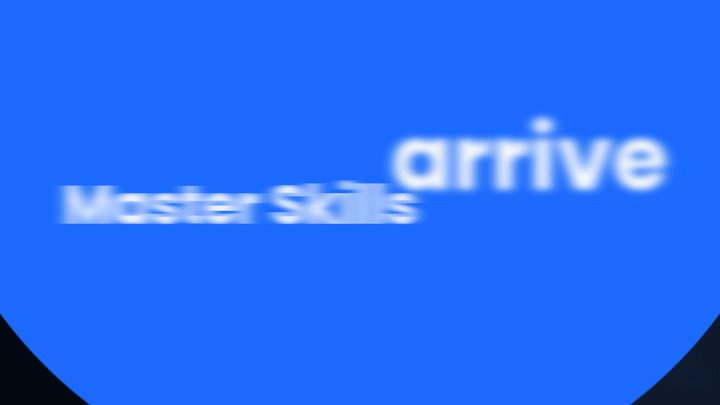

# 👑 Master King Motion

**Un skill Claude pour produire des vidéos motion design de niveau studio, inspirées au détail près d'une vidéo de référence, mais avec votre contenu.**

Vous donnez une vidéo d'inspiration (une pub, un lancement, une promo d'app) et votre contenu : textes, logo, captures, couleurs, musique, voix off.
Claude mesure l'ADN de la référence (rythme, courbes d'animation, durées, transitions, typo, palette, finition), le recrée entièrement en code, puis l'applique à votre marque. La ressemblance est **prouvée par des mesures**, pas estimée à l'œil.

> Tout est recréé en code (HTML / SVG / GSAP / Three.js / Blender). Aucun élément n'est extrait de la vidéo de référence.

<p align="center"></p>
<p align="center"><em>Extrait du lancement « Master Skills », produit avec ce skill.</em></p>

> ⚠️ **Fonctionne avec Claude Code** (terminal, application de bureau ou claude.ai/code). Le skill exécute des programmes
> et installe Blender : il ne fonctionne pas dans la simple discussion claude.ai ni dans l'application mobile.

---

## ✨ Ce que fait le skill

### Deux modes, choisis automatiquement par Claude

| Mode | Quand | Résultat |
|---|---|---|
| ⚡ **Rapide** (par défaut) | « Fais la même vidéo pour ma marque » | Le mouvement de la référence est mesuré (coupes, durées, courbes, rythme) puis appliqué à votre contenu. Rapide et économe en usage. |
| 🎯 **Studio** | Vous demandez une copie exacte (« identique », « au pixel près »), ou une scène résiste aux contrôles | La référence est d'abord reproduite au pixel près (95 % de ressemblance mesurée par scène), puis adaptée. Plus long. |

Vous n'avez rien à choisir : Claude annonce le mode en une phrase. Il passe une scène en Studio de lui-même si les
contrôles de rythme ou de style échouent deux fois, et il charge seul les règles expertes utiles (3D, voix, textes…)
au moment où elles servent.

### Les étapes

| Étape | Ce qui se passe |
|---|---|
| **1. Mesure** | Coupes, scènes, palette, énergie de mouvement, courbes d'easing GSAP, tempo, flou de mouvement, grain. En mode Studio : reproduction image par image en code d'abord. |
| **2. Plan** | Chaque scène de la référence reçoit votre contenu, avec votre palette et vos polices. |
| **3. Script de voix** | Un script écrit plan par plan sur le rythme de la référence, à générer dans votre outil de voix. |
| **4. Storyboard** | Une image par scène en rendu réel, pour validation avant le rendu final. |
| **5. Adaptation** | Vos textes, couleurs et visuels sur les pistes de mouvement mesurées. La voix est calée mot par mot, la musique mixée sous la voix. |
| **6. Rendu et preuves** | Rendu 1080p (ou 9:16, 1:1, 4:5). Contrôles de rythme (`rhythm.py`), de tremblement, de fantômes et de style. |

**Ce qui est inclus :**
- **72 scripts Python** de mesure et de vérification : suivi d'éléments, homographies, ajustement d'easing, audit, lissage, rythme.
- **Un moteur de rendu** Chromium + GSAP + Three.js, image par image, avec flou de mouvement.
- **De la 3D photoréaliste dans Blender Cycles** : smartphone modélisé, icônes, objets, composités sur fond transparent.
- **121 règles d'or** apprises sur des projets réels (`references/rules.md`).

---

## 🚀 Installation : vous n'avez rien à installer à la main

Placez le skill dans vos skills Claude Code :

```bash
git clone https://github.com/oriaagentpro-a11y/master-king-motion.git ~/.claude/skills/master-king-motion
```

C'est tout. **À la première vidéo demandée, Claude installe lui-même tout ce dont le skill a besoin**, sans vous poser de question :

| Composant | Rôle |
|---|---|
| Node.js, Python, FFmpeg, git | outils de base (installés s'ils manquent : apt / dnf / pacman, Homebrew sur Mac, winget sur Windows) |
| GSAP, Three.js, Playwright + Chromium | moteur de rendu image par image |
| OpenCV, scikit-image, SciPy, librosa… | mesure de la référence, audio, rythme |
| faster-whisper + son modèle | calage de la voix off mot à mot |
| **Blender 4.2 LTS** | 3D photoréaliste (Cycles), installé dans le dossier du skill |

L'installation se fait une seule fois (5 à 15 min selon la connexion) et se termine par un rendu de test. Les fois suivantes, la vérification prend quelques secondes. Seul un mot de passe administrateur peut vous être demandé si votre système l'exige.

**Installer à l'avance, sans Claude** (facultatif) :

```bash
python3 ~/.claude/skills/master-king-motion/scripts/ensure_ready.py
```

Sous Windows (PowerShell), depuis le dossier du skill :

```powershell
powershell -ExecutionPolicy Bypass -File install.ps1
```

Le diagnostic final doit afficher **« Tout est prêt »**.

---

## 🎬 Utilisation

Démarrez un projet :

```bash
python3 scripts/new_project.py mon_projet --ref reference.mp4 --music musique.mp3 --voice voix.wav --format 16:9
```

Puis demandez simplement à Claude :

> « Voici ma vidéo de référence et mon affiche. Reproduis le motion au détail près pour mon lancement. »

Claude suit les 7 phases décrites dans `SKILL.md`. Il vous rend un storyboard à valider avant le rendu final.

**Formats :** 16:9 (1920×1080) par défaut. Précisez *vertical / TikTok / Reels* pour du 9:16, *carré* pour du 1:1, *post Instagram* pour du 4:5.

**Audio :** vous fournissez la musique et la voix off. Si elles manquent, Claude vous propose un script de voix minuté
(une ligne par plan) et une direction musicale. Pour la voix : votre propre enregistrement (même au téléphone), ou un
outil de synthèse vocale gratuit et open source comme Piper ou Kokoro. Le pack Master Skills inclut aussi un outil de voix off.

**Durée :** avant chaque long rendu (3D Blender, Full HD), Claude mesure une image et vous annonce la durée totale.
La 3D utilise automatiquement votre carte graphique si vous en avez une (NVIDIA, AMD, Apple Silicon).
Prévoyez environ 3 Go d'espace disque pour l'installation.

---

## 📁 Structure

```
master-king-motion/
├── SKILL.md            ← le skill : 7 phases, pipeline, règles absolues
├── install.sh / .ps1   ← installation complète automatique (Blender compris)
├── references/
│   ├── essentials.md   ← l'essentiel lu avant chaque vidéo : modes, déclencheurs
│   ├── rules.md        ← 121 règles d'or, chargées sujet par sujet (scripts/rules.py)
│   ├── workflow.md     ← les commandes de chaque phase
│   ├── doctrine.md     ← les règles de qualité
│   ├── verification.md ← la passe image par image avant livraison
│   └── reverse-motion-METHODS.md
├── scripts/            ← mesure, suivi, audit, rythme, assemblage (Python)
│   └── wordfit/        ← ajustement des textes et des phrases
├── engine/             ← moteur de rendu (render.mjs, GSAP, Three.js)
├── blender/            ← 3D Cycles : téléphone, icônes, objets
├── templates/          ← gabarit de film HTML
└── examples/demo/      ← démo libre de droits de bout en bout
```

---

## 🧪 Essayer la démo

```bash
cd examples/demo && python3 make_source.py
```

```bash
python3 ../../scripts/assemble.py manifest.json out
```

```bash
python3 ../../scripts/assemble.py manifest.json out_brand --brand brand.example.js
```

Vous obtenez une copie fidèle de la vidéo source, puis sa version aux couleurs d'une autre marque.

---

## ⚖️ Usage responsable

- Les vidéos que vous prenez comme référence restent la propriété de leurs auteurs. Servez-vous-en comme **inspiration de mouvement**, pas pour copier une marque, un logo ou des personnages.
- Le paquet ne contient aucune vidéo, image ou plaque tirée d'une œuvre tierce.
- Vérifiez les droits de la musique et des voix que vous utilisez.

## 📜 Licence et crédits

Code sous licence **MIT** (voir `LICENSE`). La police Outfit est sous licence SIL OFL 1.1. Les dépendances et ressources tierces sont listées dans `CREDITS.md`.

Moteur de mesure dérivé de *reverse-motion* (MIT).

---

**Créé par Marion de SOUZA**, Graphiste Pro · AI Workflow Architect · AI Software Builder.
